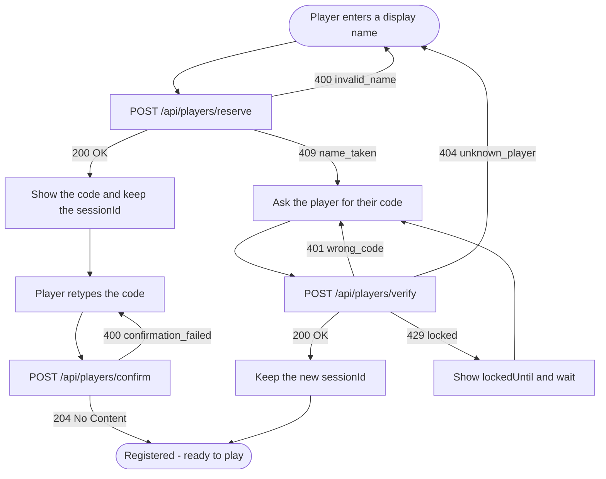
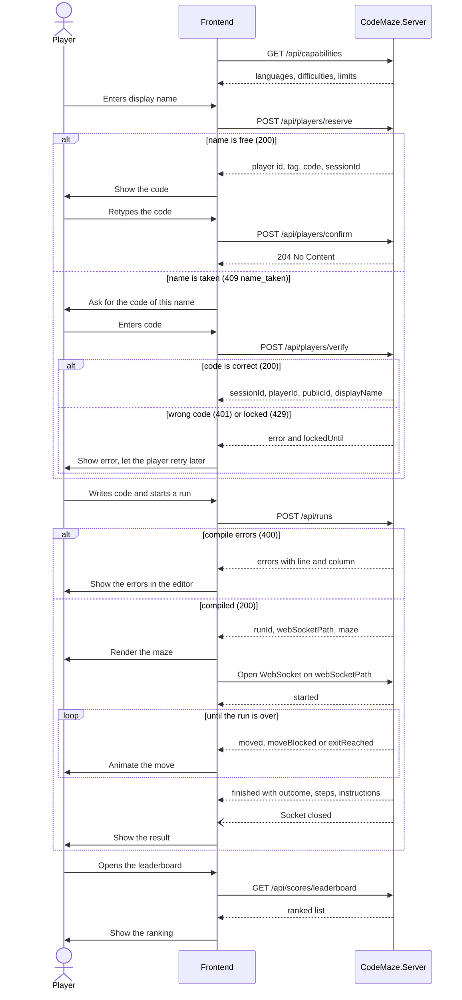

# CodeMaze.Server API

Controlling backend for the maze coding game. The frontend sends code written in the game's DSL,
the server compiles it, runs it in the interpreter and streams the interpreter's events back over a
WebSocket. Players identify themselves with a reserved display name and can be ranked on a leaderboard.

Eight endpoints exist today:

| Endpoint | Purpose |
|---|---|
| `GET  /api/capabilities` | What the server supports: languages, difficulties, limits |
| `GET  /api/maze` | Generate a maze with any configured algorithm for the size (difficulty ignored) |
| `GET  /api/maze/{difficulty}` | Generate a maze for a specific difficulty |
| `POST /api/runs` | Prepare a run: compile the code and settle on a maze |
| `GET  /api/runs/{runId}/ws` | WebSocket: execute the prepared run and stream its events |
| `POST /api/players/reserve` | Reserve a display name and receive a confirmation code and a session key |
| `POST /api/players/confirm` | Finish registration by retyping the confirmation code |
| `POST /api/players/verify` | Returning player proves ownership of a name and receives a session key |
| `GET  /api/scores/leaderboard` | Ranked list of players and their points per session |
| `GET  /api/scores/{playerId}/{sessionId}` | Aggregated score for one player in one session |

Typical flow: `GET /api/capabilities` once on startup, then identify the player (see [Player flow](#player-flow)),
then per run `POST /api/runs` followed by the WebSocket. The leaderboard can be fetched at any time.

Status: work in progress. There is no authentication on the maze and run endpoints yet; players are identified
by a reserved name plus a code (see [Players](#players)).

## Conventions

- JSON everywhere, property names in `camelCase`.
- Coordinates are zero-based. `y` is the row (row 0 is the top row), `x` is the column (column 0 is the leftmost).
- A position is always `{ "y": 0, "x": 1 }`.
- Enums are sent as camelCase strings (`"hard"`, `"exitReached"`).
- Directions are `up`, `down`, `left`, `right` and `back` (a step back through the walked path).
- The player endpoints report errors as `{ "error": "<code>" }` (see [Players](#players)). The run and maze endpoints
  use the error shapes described in their own sections.

### Maze format

Used by `GET /api/maze`, `GET /api/maze/{difficulty}`, by `POST /api/runs` (request and response).

```json
{
  "width": 3,
  "height": 2,
  "entrance": { "y": 0, "x": 1 },
  "exit":     { "y": 1, "x": 2 },
  "cells": [
    { "y": 0, "x": 0, "walls": ["top", "left"] },
    { "y": 0, "x": 1, "walls": ["top"] },
    { "y": 1, "x": 1, "walls": [] }
  ]
}
```

- `walls` contains any of `top`, `right`, `bottom`, `left`.
- The example is abbreviated. A real maze lists **every** cell (`width * height` of them), row by row.
  When sending a maze to the server, every cell must appear exactly once, and entrance and exit must lie inside the maze,
  otherwise the request is rejected with a 400.

---

## Player flow

The diagrams below show the whole API as the frontend uses it, from a player stepping up to the game until the
leaderboard is shown.

### Identifying the player

A display name can only be reserved once. If the name is already taken, the frontend asks the player for the code they
received when they first reserved it and verifies it instead.



### From stepping up to the leaderboard



---

## `GET /api/capabilities`

Tells the frontend what this server supports, so dropdowns and client-side validation do not have to be hard-coded.
Call it once on startup.

**200 OK**

```json
{
  "languages": [
    { "name": "de", "displayName": "Deutsch" },
    { "name": "en", "displayName": "English" }
  ],
  "difficulties": ["easy", "medium", "hard"],
  "defaultDifficulty": "medium",
  "maze": { "minSize": 2, "maxSize": 100, "maxCells": 10000 },
  "run": {
    "maxCodeLength": 20000,
    "maxLanguageDefinitionLength": 20000,
    "minStepDelayMs": 0,
    "maxStepDelayMs": 2000,
    "defaultStepDelayMs": 100
  },
  "interpreter": { "onCollision": "crash", "stopAtExit": true }
}
```

| Field | Meaning |
|---|---|
| `languages` | Languages the server has: the built-in ones (currently `de` and `en`) plus any the operators added. `name` is what you send as `language` in `POST /api/runs`; `displayName` is for the UI. |
| `difficulties` | Accepted values for `difficulty` (the `{difficulty}` segment of `GET /api/maze/{difficulty}` and the `difficulty` field of `POST /api/runs`). |
| `defaultDifficulty` | Used by `POST /api/runs` when `difficulty` is omitted. `GET /api/maze` has no default: without a difficulty it picks from all difficulties. |
| `maze` | Accepted `size` range, and the maximum number of cells for a maze you send yourself. A size inside this range can still be answered with `404` by the maze endpoints if no generator is configured for it (see [Maze generation configuration](#maze-generation-configuration)). |
| `run` | Limits for `POST /api/runs`. |
| `interpreter.onCollision` | `crash`: running into a wall ends the run (`finished` / `crashed`). `ignore`: a `moveBlocked` event is sent and the run continues. |
| `interpreter.stopAtExit` | `true`: the run ends as soon as the exit is reached (`finished` / `exitReached`). `false`: the program keeps running. |

Custom languages sent with a run are not listed here; the server only lists the ones it ships with.

---

## `GET /api/maze`

Generates a square maze for the given size. The difficulty is **not** considered: the server looks up every
generator algorithm configured for this size, regardless of difficulty, and picks one of them at random.

| Query parameter | Type | Required | Notes |
|---|---|---|---|
| `size` | int | yes | Width and height in cells. 2 to 100. |

```
GET /api/maze?size=10
```

**200 OK**: a maze (see [Maze format](#maze-format)).

**400 Bad Request**: `size` missing or out of range.

**404 Not Found**: no generator algorithm is configured for this size. The body is a plain-text message,
e.g. `No generator algorithm is configured for size 150x150.`

---

## `GET /api/maze/{difficulty}`

Generates a square maze for the given size and difficulty. Only algorithms configured for this exact
combination are considered; if several match, one of them is picked at random.

| Parameter | Where | Type | Required | Notes |
|---|---|---|---|---|
| `difficulty` | path | string | yes | `easy`, `medium` or `hard`. |
| `size` | query | int | yes | Width and height in cells. 2 to 100. |

```
GET /api/maze/hard?size=10
```

**200 OK**: a maze (see [Maze format](#maze-format)).

**400 Bad Request**: `size` missing or out of range, or unknown `difficulty`.
An unknown difficulty string is rejected by model binding with `application/problem+json`;
other invalid values are answered with the plain text `Unknown difficulty.`

**404 Not Found**: no generator algorithm is configured for this size and difficulty,
e.g. `No generator algorithm is configured for size 50x50 with difficulty Easy.`

> **Change from earlier versions:** `difficulty` used to be an optional query parameter of `GET /api/maze`
> (default `medium`). It is now a path segment, and `GET /api/maze` without it means "any difficulty".
> `GET /api/maze?size=10&difficulty=hard` no longer selects a difficulty: the parameter is ignored.

---

## Maze generation configuration

Which algorithm serves which size and difficulty is defined by the server operator in `appsettings.json`
under `MazeGeneration:Mappings`. Algorithms are referred to by the name they were registered with.

```json
{
  "MazeGeneration": {
    "Mappings": [
      { "Size": { "Min": 1,  "Max": 10  }, "Difficulty": "Easy",   "Algorithm": "RecursiveBacktracker" },
      { "Size": { "Min": 1,  "Max": 10  }, "Difficulty": "Medium", "Algorithm": "Prims" },
      { "Size": { "Min": 11, "Max": 30  }, "Difficulty": "Medium", "Algorithm": "Prims" },
      { "Size": { "Min": 11, "Max": 30  }, "Difficulty": "Medium", "Algorithm": "Kruskals" },
      {
        "Height": { "Min": 31, "Max": 100 },
        "Width":  { "Min": 31, "Max": 200 },
        "Difficulty": "Hard",
        "Algorithm": "Kruskals"
      }
    ]
  }
}
```

- `Size` applies to both height and width; `Height` and `Width` override it individually.
- Ranges are inclusive and may overlap. When several entries match a request, one is picked at random.
- A size (or size and difficulty) that no entry covers is answered with `404`.
- The configuration is validated when the server first needs it: an unknown algorithm name, an invalid range
  or an empty list makes the server fail with a message pointing at the faulty config path.
- Changes require a server restart.

---

## `POST /api/runs`

First half of starting a run. The server compiles the code right away, so syntax errors are reported here and not over the socket.
It then settles on the maze (yours, or a generated one) and returns a one-time id for the WebSocket.

### Request

```json
{
  "code": "forever\n  go right\nend",
  "language": "en",
  "languageDefinition": "name = \"custom\"\n[keywords]\n...",
  "maze": { "...": "optional, see Maze format" },
  "size": 10,
  "difficulty": "medium",
  "stepDelayMs": 100
}
```

| Field | Type | Required | Notes |
|---|---|---|---|
| `code` | string | yes | DSL source. Max 20,000 characters. |
| `language` | string | one of the two | Name of a language the server has (see `GET /api/capabilities`). Case-insensitive. |
| `languageDefinition` | string | one of the two | The text of a custom language definition (TOML, see below). Max 20,000 characters. |
| `maze` | maze | no | If present, this maze is used as is and `size` / `difficulty` are ignored. At most 10,000 cells (100 x 100). |
| `size` | int | if no `maze` | 2 to 100. Square maze of `size` x `size`. |
| `difficulty` | string | no | `easy`, `medium`, `hard`. Default `medium`. Only used when a maze is generated. |
| `stepDelayMs` | int | no | Pause after each `moved` event, so the frontend can animate. 0 to 2000, default 100. Out-of-range values are clamped. |

Exactly one of `language` / `languageDefinition` is needed. If both are sent, `languageDefinition` wins and `language` is ignored.
If neither is sent the request is rejected.

`languageDefinition` is plain text in TOML format that maps the language's words to the keywords of the game:

```toml
name = "custom"
display_name = "My language"
comment_prefix = "#"

[keywords]
go = "gehe"
# one entry per keyword, each a string or an array of strings
```

The definition is validated on every request; problems come back as `language` errors (see below).

### Response, 200 OK

```json
{
  "runId": "3f0c8d0e-6a1f-4b3e-9d57-6f3b1c2a9e11",
  "webSocketPath": "/api/runs/3f0c8d0e-6a1f-4b3e-9d57-6f3b1c2a9e11/ws",
  "maze": { "...": "the maze that will be used (the generated one if you did not send one)" }
}
```

Render the maze from this response. The run id is valid for **60 seconds** and can be used **once**.

### Errors, 400 Bad Request

There are three different error shapes, so check the content type / structure:

1. **Language and code errors** (a broken language definition; syntax errors, unknown functions, wrong argument counts, ...). All errors found are returned at once:

   ```json
   {
     "errors": [
       { "source": "code", "message": "Expected 'end' but found end of program.", "line": 4, "column": 1 }
     ]
   }
   ```

   `source` is `code` for problems in the program, or `language` for problems in a `languageDefinition`.
   `line` and `column` are 1-based and may be `null` when an error has no position (always the case for `language` errors; the line may be part of the message).

2. **Plain text** for request validation done by the endpoint, e.g. `code is required.`,
   `Provide a maze, or a size between 2 and 100.`, `The provided maze is too large.`, `Unknown language 'xx'. Available: de, en.`, `Provide a language name or a languageDefinition.`

3. **Standard ASP.NET problem details** (`application/problem+json`) when the body cannot be read at all:
   malformed JSON, missing `code`, a maze that is structurally invalid, an unknown `difficulty` string.

```bash
curl -X POST http://localhost:5000/api/runs \
  -H "Content-Type: application/json" \
  -d '{ "code": "go right", "size": 5, "difficulty": "easy" }'
```

---

## `GET /api/runs/{runId}/ws`  (WebSocket)

Second half of starting a run. Open a WebSocket to the `webSocketPath` from `POST /api/runs`
(same host; `ws://` or `wss://` to match the page).

```js
const { webSocketPath } = await (await fetch("/api/runs", { /* ... */ })).json();
const ws = new WebSocket(`${location.protocol === "https:" ? "wss" : "ws"}://${location.host}${webSocketPath}`);
ws.onmessage = e => handle(JSON.parse(e.data));
```

The interpreter starts as soon as the socket is open.

**Before the upgrade** the server answers with a plain HTTP status:
`400` if the request is not a WebSocket request, `404` if the run id is unknown, expired or was already used.

### Server to client

Every message is one JSON event with a `type` field. Order is always: `started`, then any number of
`moved` / `moveBlocked` / `exitReached`, then exactly one `finished`.

**`started`**: the run begins.

```json
{ "type": "started", "position": { "y": 0, "x": 1 }, "exit": { "y": 1, "x": 2 } }
```

**`moved`**: a successful move. `direction` is the requested direction (`back` for a step back). `step` counts successful moves.

```json
{ "type": "moved", "from": { "y": 0, "x": 1 }, "to": { "y": 0, "x": 2 }, "direction": "right", "step": 1 }
```

**`moveBlocked`**: a move was not possible. `reason` is `wall` or `noHistory` (nothing to go back to).
Whether the run continues or ends right after with `finished` / `crashed` is announced by `interpreter.onCollision` in `GET /api/capabilities`.

```json
{ "type": "moveBlocked", "position": { "y": 0, "x": 2 }, "direction": "up", "reason": "wall" }
```

**`exitReached`**: the exit cell was reached (sent once). If `interpreter.stopAtExit` in `GET /api/capabilities` is `true`, the run then ends with `finished` / `exitReached`.

```json
{ "type": "exitReached", "position": { "y": 1, "x": 2 }, "steps": 4 }
```

**`finished`**: always the last message of a run, also after a cancel. `message` may be `null`.

```json
{
  "type": "finished",
  "outcome": "exitReached",
  "message": null,
  "position": { "y": 1, "x": 2 },
  "steps": 4,
  "instructions": 37
}
```

| `outcome` | Meaning |
|---|---|
| `exitReached` | The program reached the exit and the run was stopped there. |
| `programEnded` | The program ran to its end. |
| `crashed` | The program ran into a wall (or tried to go back with no history). `message` explains. |
| `cancelled` | The client cancelled the run. |
| `limitExceeded` | Too many instructions or too deep recursion (for example an endless loop that never moves). |
| `fault` | Internal error or malformed compiler output. Should not happen; report it. |

After `finished` the server closes the socket normally.

### Client to server

Only one message exists:

```json
{ "type": "cancel" }
```

It can be sent at any time. The interpreter stops and the server sends `finished` with outcome `cancelled`
(events that were already on their way may still arrive before it). Closing the socket or losing the connection also cancels the run.
Malformed or unknown messages are ignored; messages larger than 4 KB end the run.

---

## Players

Players identify themselves with a **display name** that they reserve once. When a name is reserved the server
generates a **code**; whoever knows the name and the code owns that player. There are no passwords or accounts.
Each player also gets a public tag of the form `#007` (the player id, zero-padded to three digits), which is shown
next to the display name so that names stay distinguishable.

The endpoints return a `sessionId` (a session key). A session is what scores are grouped by on the
[leaderboard](#get-apiscoresleaderboard).

All player errors are JSON of the form `{ "error": "<code>" }`.

### `POST /api/players/reserve`

Reserves a display name. On success the server returns the generated code and a session key **right away**, so the
player can start playing before registration is confirmed.

**Request**

```json
{ "displayName": "Ada" }
```

**200 OK**

```json
{
  "id": 7,
  "publicId": "#007",
  "displayName": "Ada",
  "code": "<generated code>",
  "sessionId": "<session key>"
}
```

Show the `code` to the player and ask them to retype it ([`confirm`](#post-apiplayersconfirm)). They also need it
later to come back as the same player.

| Status | Body | Meaning |
|---|---|---|
| `400` | `{ "error": "invalid_name" }` | The display name is not acceptable. |
| `409` | `{ "error": "name_taken" }` | The name is already reserved. Ask the player for their code and call [`verify`](#post-apiplayersverify) instead. |

### `POST /api/players/confirm`

Finishes registration: the player retypes the code they were shown after `reserve`.

**Request**

```json
{ "displayName": "Ada", "code": "<code from reserve>" }
```

| Status | Body | Meaning |
|---|---|---|
| `204` | none | Confirmed. |
| `400` | `{ "error": "confirmation_failed" }` | The code does not match. Let the player try again. |

### `POST /api/players/verify`

A returning player proves ownership of a name by sending the code they received when the name was reserved.
Returns a fresh session key.

**Request**

```json
{ "displayName": "Ada", "code": "<code from reserve>" }
```

**200 OK**

```json
{
  "sessionId": "<session key>",
  "playerId": 7,
  "publicId": "#007",
  "displayName": "Ada"
}
```

| Status | Body | Meaning |
|---|---|---|
| `401` | `{ "error": "wrong_code", "lockedUntil": ... }` | The code is wrong. `lockedUntil` tells when the name is locked until (may be `null` while no lock is active yet). |
| `404` | `{ "error": "unknown_player" }` | No player with this name exists. |
| `429` | `{ "error": "locked", "lockedUntil": ... }` | Too many wrong attempts. The name is locked until `lockedUntil`; do not retry before then. |

---

## `GET /api/scores/leaderboard`

Ranks players by their total points. Points of the same session are summed, so every row is one player in one
session, not one single run.

| Query parameter | Type | Required | Notes |
|---|---|---|---|
| `top` | int | no | Maximum number of rows. `0` returns all rows and is also the default when the parameter is omitted. Negative values are rejected. |

```
GET /api/scores/leaderboard?top=10
```

**200 OK**: an array, best first.

```json
[
  {
    "rank": 1,
    "session": "<session key>",
    "playerTag": "#007",
    "displayName": "Ada",
    "totalPoints": 1250,
    "averageEfficiency": 0.82,
    "lastPlayedAt": "2026-10-27T09:15:00Z"
  }
]
```

| Field | Meaning |
|---|---|
| `rank` | Position in the list, starting at 1. Equal points do not share a rank. |
| `session` | The session the points were collected in. |
| `playerTag` | Public tag of the player, e.g. `#007`. |
| `displayName` | The player's display name. |
| `totalPoints` | Sum of all points of this player in this session. |
| `averageEfficiency` | Average efficiency over the scores of this session. |
| `lastPlayedAt` | Time of the most recent score in this session. |

**Ordering:** `totalPoints` descending. On a tie the row whose `lastPlayedAt` is **earlier** ranks higher (whoever reached
the points first), then `session` as the last tie-breaker.

**400 Bad Request**: `top` is negative. The body is the plain text `The top parameter must be 0 or greater.`

The leaderboard is public and needs no session key. Because `top` defaults to `0`, a call without it returns
**every** row; pass `top` for anything shown in the UI.

---

## `GET /api/scores/{playerId}/{sessionId}`

Retrieves the aggregated score for a specific player in a specific session. Like the leaderboard, it sums points
from all score records matching that player and session.

| Parameter | Where | Type | Required | Notes |
|---|---|---|---|---|
| `playerId` | path | int | yes | Numeric player ID. |
| `sessionId` | path | GUID | yes | Session UUID returned by the player reserve or verify endpoints. |

```http
GET /api/scores/7/3f0c8d0e-6a1f-4b3e-9d57-6f3b1c2a9e11
```

**200 OK**

```json
{
  "session": "3f0c8d0e-6a1f-4b3e-9d57-6f3b1c2a9e11",
  "playerTag": "#007",
  "displayName": "Ada",
  "totalPoints": 1250,
  "averageEfficiency": 0.82,
  "lastPlayedAt": "2026-10-27T09:15:00Z"
}
```

| Field | Meaning |
|---|---|
| `session` | The session UUID the points were collected in. |
| `playerTag` | Public tag of the player, e.g. `#007`. |
| `displayName` | The player's display name. |
| `totalPoints` | Sum of all points for this player in this session. |
| `averageEfficiency` | Average efficiency across the matching score records. |
| `lastPlayedAt` | Timestamp of the most recent matching score. |

**404 Not Found**: no score records exist for the specified player and session. The body is the plain-text message
`No score found for this player in this session.`

This endpoint does not return a leaderboard rank; use `GET /api/scores/leaderboard` for rankings.

---

## Known limitations

- Maze generation is driven by `MazeGeneration:Mappings` in `appsettings.json`. Sizes or size/difficulty combinations
  not covered there are answered with `404` by the maze endpoints, even when the size is inside `maze.minSize` to `maze.maxSize`.
- The maze and run endpoints have no authentication. The run id (an unguessable, one-time value) is the only protection of the WebSocket.
  Players are identified by name and code only, there are no passwords or accounts.
- `reserve` hands out a session key before `confirm` has been called, so confirmation is not required to play.
- Prepared runs are kept in server memory, so the API currently only works with a single server instance.
- The leaderboard returns all rows when `top` is omitted or `0`.
- Browsers need the frontend origin to be configured (`Cors:AllowedOrigins`) when it is not served from the same origin as the API.